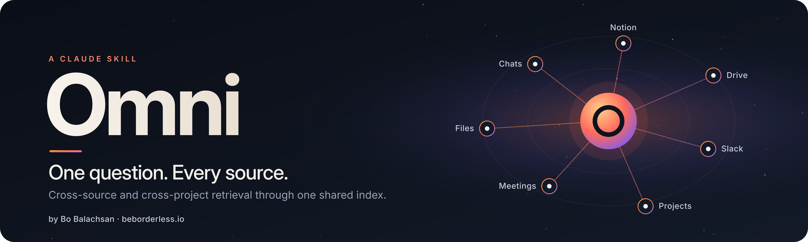
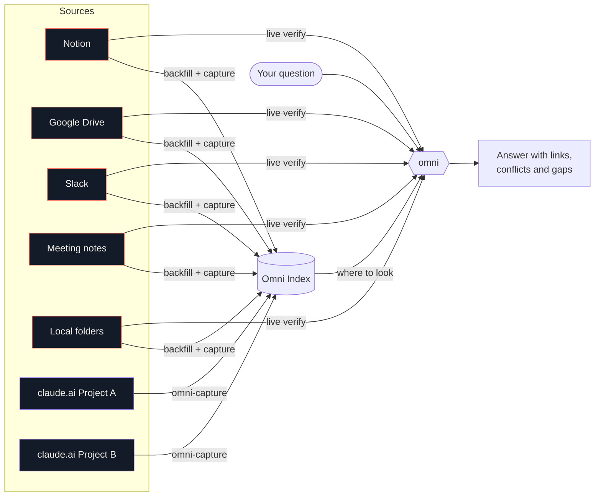

<p align="center">
  
</p>

<p align="center">
  <a href="https://github.com/borderlessismore/omni-skill/releases/latest"></a>
  <a href="https://github.com/borderlessismore/omni-skill/actions/workflows/validate.yml"></a>
  <a href="LICENSE"></a>
  
  
</p>

<p align="center">
  <b>Ask once. Omni searches Notion, Google Drive, Slack, meeting notes, local folders, past chats and your claude.ai Projects, and answers with linked evidence from each.</b>
</p>

---

## Why Omni

Your knowledge doesn't live in one place. A decision starts in a meeting transcript, gets argued in Slack, is written up in Notion, and turns up again months later in a claude.ai Project. Ask Claude about it and it only sees the one place it's looking.

claude.ai Projects make this worse: each one is walled off, so Claude working in one Project can't read another.

Omni fixes this with a small, shared **Omni Index**, a map of what exists across your sources and where to reopen it. Claude reads the map, opens the originals through your connectors, and answers with every source cited. A capture skill feeds each Project into the index, so walled-off Projects become searchable from anywhere.

## What's inside

| Skill | What it does | Say |
|---|---|---|
| **[`omni`](skills/omni/SKILL.md)** | Answers a question across every source: brief, find, timeline, connect or audit | *"What have we decided about pricing, across everything?"* |
| **[`omni-onboarding`](skills/omni-onboarding/SKILL.md)** | Sets up the index in Notion, Google Drive or a local folder in about ten minutes, with a first backfill | *"Set up Omni"* |
| **[`omni-capture`](skills/omni-capture/SKILL.md)** | Writes the current conversation, a whole Project or a document into the index | *"Capture this Project"* |

Each skill is self-contained, so you can install all three or only the ones you need.

## How it works



1. **Locate.** Omni finds your `Omni Config` and `Omni Index` from a pinned pointer or by title in your connected stores.
2. **Search.** It expands your question with your own vocabulary (old names, acronyms) and ranks index entries.
3. **Verify.** It opens the top originals through your connectors, so answers rest on the source and not only on the summary.
4. **Fill gaps.** It searches live sources for anything the index doesn't have yet.
5. **Answer.** You get a synthesis, findings grouped by source with links, conflicts between sources, and an honest list of what it couldn't check.

## Install

### Claude Code (plugin marketplace)

```text
/plugin marketplace add borderlessismore/omni-skill
/plugin install omni@omni-skill
```

All three skills install together. Update later with `/plugin marketplace update omni-skill`.

### claude.ai and the Claude desktop app

1. Download `omni.zip`, `omni-onboarding.zip` and `omni-capture.zip` from the [latest release](https://github.com/borderlessismore/omni-skill/releases/latest).
2. In Claude, open **Settings → Capabilities**, make sure code execution is on, and upload each ZIP under **Skills**.
3. Connect the apps you want Omni to search (Notion, Google Drive, Slack and so on) under **Settings → Connectors**.

### Manual (Claude Code, any agent that reads Agent Skills)

```bash
git clone https://github.com/borderlessismore/omni-skill.git
cp -r omni-skill/skills/* ~/.claude/skills/
```

## Quick start

1. **Onboard.** Say *"Set up Omni."* The onboarding skill shows which sources it can reach, suggests where to keep the index, creates it, backfills your most recent material, and runs a test query.
2. **Pin it.** Add the one line it gives you (`Omni Config: <link>`) to your preferences or Project instructions, so every chat finds the index without asking.
3. **Bring in your Projects.** Open each claude.ai Project once and say *"Run omni-capture for this whole Project."*
4. **Ask.** *"What do I know about X?"* from any chat or Project.

## Using Omni

| Mode | Example | You get |
|---|---|---|
| **Brief** | *"Summarise everything on the onboarding redesign."* | Synthesis, then evidence by source |
| **Find** | *"Where did I write the launch checklist?"* | A ranked list of locations |
| **Timeline** | *"How did our pricing evolve?"* | A dated sequence with decisions marked |
| **Connect** | *"What relates to the facilitation toolkit that I haven't linked?"* | Entries that share topics or people but were never connected |
| **Audit** | *"Clean up the Omni index."* | Stale, duplicate and broken entries with proposed fixes |

Keep the index fresh by saying *"Capture this"* at the end of any session worth remembering. Omni will also offer to capture what it finds outside the index.

## The index

Entries are short pointers, never copies of your content:

```markdown
## omni-20260520-membership-pricing-decision · Membership pricing decision
- kind: decision
- summary: Two tiers at EUR 29 and EUR 79 a month. The middle tier was dropped after member interviews.
- topics: pricing, membership, community
- source: notion / Team workspace
- location: https://www.notion.so/example-pricing-decision
- date: 2026-05-14
```

The same fields map to a Notion database or a Google Sheet. The full schema is in [`shared/index-schema.md`](shared/index-schema.md), and a worked example is in [`examples/`](examples).

For Markdown indexes, a dependency-free script validates and searches entries:

```bash
python3 skills/omni/scripts/omni_index.py validate omni-index.md
python3 skills/omni/scripts/omni_index.py search omni-index.md "pricing" --config omni-config.md
python3 skills/omni/scripts/omni_index.py stats omni-index.md
```

## Limits, privacy and trust

- **Omni can't break the walls between Projects.** It sees another Project only through what `omni-capture` wrote from inside it. It says so when that matters to an answer.
- **It only reaches what you've connected.** Unconnected sources are listed as gaps, not guessed at.
- **Your data stays in your tools.** The index lives in your own Notion, Drive or folder. This repository contains instructions and a small local script; nothing is sent anywhere else.
- **Summaries stay professional.** The capture rules exclude health, financial-account, ID and other sensitive personal details, even when a source contains them.
- **Sources beat summaries.** When the index and an original disagree, Omni trusts the original and flags the stale entry.

## Repository layout

```text
omni-skill/
├── .claude-plugin/         plugin.json + marketplace.json (Claude Code install)
├── skills/
│   ├── omni/               search skill: SKILL.md, references/, scripts/
│   ├── omni-onboarding/    setup skill: SKILL.md, references/, templates/, scripts/
│   └── omni-capture/       capture skill: SKILL.md, references/, scripts/
├── shared/                 source of truth for files copied into each skill
├── examples/               a fictional index and config
├── evals/                  behaviour scenarios for testing the skills
├── tests/                  unit tests for the index script
├── tools/                  sync, lint and packaging scripts
└── assets/                 header and social preview
```

## Development

```bash
python3 tools/sync_shared.py          # copy shared/ into each skill after editing it
python3 tools/validate_skills.py      # lint frontmatter, length, links and versions
python3 -m unittest discover -s tests # test the index script
python3 tools/build_zips.py           # build dist/*.zip for claude.ai
```

Every push runs these checks in CI, and every `v*` tag publishes the ZIPs to a release. See [CONTRIBUTING.md](CONTRIBUTING.md) for how to propose changes and test skill behaviour against [`evals/evals.json`](evals/evals.json).

## Credits

Created by **[Bo Balachsan](https://beborderless.io/)**. More of his work is at **[beborderless.io](https://beborderless.io/)**.

Built with Claude. Released under the [MIT License](LICENSE).
